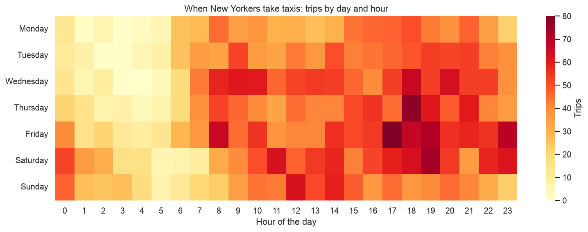
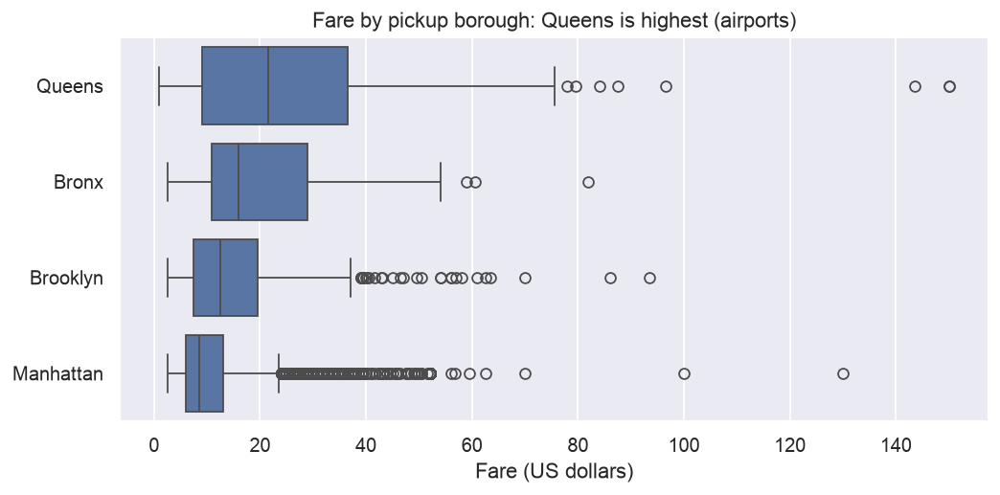
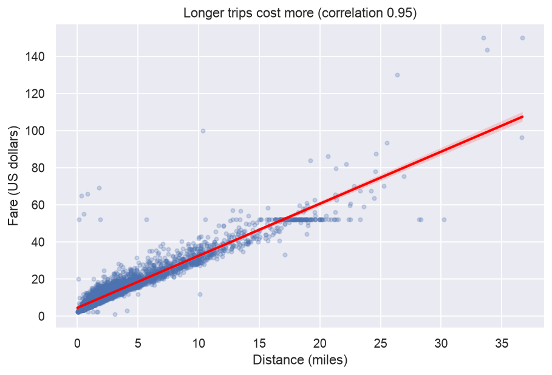
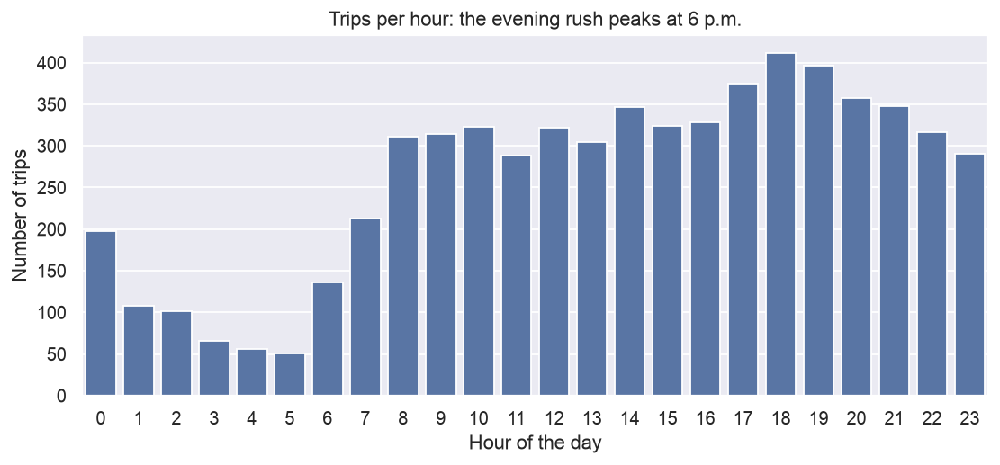
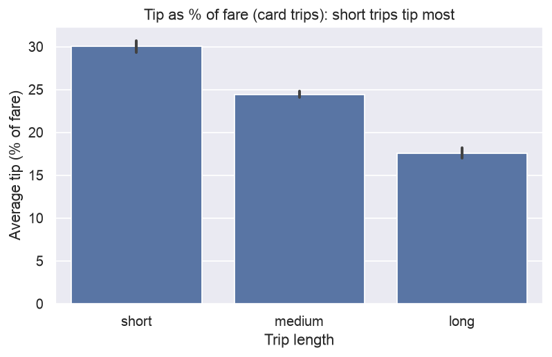

# New York Taxi Trips: When, Where and Who Tips? 🚕

An analysis of 6,433 New York City taxi trips from March 2019, done in Python with pandas, matplotlib and seaborn.

**Questions:** when are taxis busiest, where do trips start, what drives the price, and who tips the most?

👉 **[See the full analysis notebook](nyc_taxi_analysis.ipynb)**



## Key findings

1. **The evening rush is the busiest time.** 6 p.m. has the most pickups (412), followed by 7 p.m. and 5 p.m. The busiest moment of the week is Friday at 5 p.m. (80 trips).
2. **Per day, Wednesday is busiest, not Friday.** Friday has the most trips in total (1,085), but March 2019 had 5 Fridays and only 4 Wednesdays. Per day, Wednesday leads (about 237 trips) and Sunday is quietest (about 170).
3. **Manhattan is where taxis work.** 82% of trips start there, but they're short (2.4 miles) and cheap (11.13 dollars on average).
4. **Airports make Queens the most expensive borough.** Queens has the highest average fare (25.35 dollars). 45% of its pickups are at JFK or LaGuardia, where the average fare is 38.19 dollars.
5. **Distance decides the price.** Distance and fare have a correlation of 0.95.
6. **Yellow and green taxis serve different areas.** Yellow taxis made 4,876 of the 5,168 Manhattan pickups; in Brooklyn, green taxis made 305 pickups to yellow's 69.
7. **Short trips get the biggest tips in percentage terms.** Card passengers tip 30% of the fare on short trips, but 17.6% on long ones.

| | |
|---|---|
|  |  |
|  |  |

## What I did

| Step | Details |
|---|---|
| **Cleaning** | Fixed inconsistent payment labels (`"CASH"`, `" cash"`, `"Credit Card"`), removed 15 duplicate rows and 146 impossible trips (0 passengers or 0 miles), filled missing values, converted text to dates |
| **Merging** | Joined a zone-to-borough lookup table with a left merge (`left_on` / `right_on`) and checked that no rows were lost |
| **Feature engineering** | Trip duration, hour, weekday, tip %, a tipped flag (`np.where`), distance bands (`pd.cut`), time of day (custom function with `apply`) |
| **Analysis** | `groupby`, pivot tables, `value_counts`, correlation, and a per-day comparison to correct for the uneven number of weekdays in the month |
| **Charts** | Heatmap, box plot, regression plot, count plot and bar plot with seaborn and matplotlib |

## A data-quality lesson 🕵️

Every cash trip shows a tip of 0. That doesn't mean cash passengers never tip: card tips are recorded by the card machine, but cash tips go straight to the driver and never reach the data. So all tip analysis here uses **card trips only**.

## Limitations

- This is a sample from a single month, so seasonal patterns can't be seen.
- Cash tips are not recorded.
- Some groups are small (only 96 Bronx pickups), so their averages are less reliable. Bronx trips show a very low average tip (0.15 dollars), which would need more data to explain.

## Data

- Trips: a sample of NYC Taxi & Limousine Commission trip records, from the [seaborn example datasets](https://github.com/mwaskom/seaborn-data) (`taxis.csv`). The borough columns were split out into a separate lookup table (`data/zones.csv`) to practise merging.
- For cleaning practice, 15 duplicate rows and some inconsistent payment spellings were added to `data/taxi_trips.csv`. The missing values and impossible trips are in the original data.

## Files

| File | What it is |
|---|---|
| [`nyc_taxi_analysis.ipynb`](nyc_taxi_analysis.ipynb) | The full analysis, start to finish |
| `data/` | Raw trips, zone lookup and the cleaned output |
| `images/` | Charts used on this page |

**Tools:** Python, pandas, NumPy, matplotlib, seaborn, Jupyter in VS Code.

## Run it yourself

```bash
python3 -m venv .venv
source .venv/bin/activate
pip install -r requirements.txt
```

Then open `nyc_taxi_analysis.ipynb` in VS Code or Jupyter and run all the cells.
